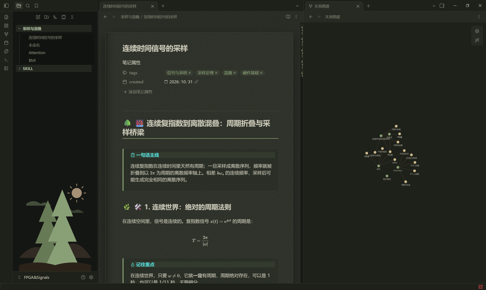

# Dark Forest 🌳 - An Antiquarian Book & Driftwood Theme

An immersive dark theme for Obsidian. It blends the deep green of a dark forest with the warm browns of driftwood and the golden light of aged parchment.

## ✨ Features

- 📖 **Centered Page Layout**: The main editor is styled like a vintage parchment with a realistic spine shadow.
- 📚 **Sliding Drawer Sidebar**: Folders look like wooden shelves, and notes slide out like drawers. A forest silhouette is tucked at the bottom.
- 🌿 **Tree Growth Headers**: H1 to H6 headers feature unique tree-themed icons (🌳, 🌿, 🪵, 🍂, 🌱, ❖).
- 🌌 **Firefly Graph View**: Graph nodes are styled in glowing moss green and warm gold, resembling fireflies in a dark forest.
- 🌿 **Vine Scrollbar**: A hand-drawn vine with leaves and a fruit serves as the custom scrollbar.
- 📊 **Wooden Table Grid**: Tables blend seamlessly into the background with a subtle, dark-wood zebra pattern.

## 🛠️ Installation

1. Download the `.zip` file from this repository and extract it.
2. Place the extracted folder into your Obsidian vault's `.obsidian/themes/` directory.
3. Open Obsidian, go to `Settings -> Appearance -> Themes`, and select `Dark Forest`.

## 👤 Author

- **Created by**: Artidle-Lancelot
- **GitHub**: [Artidle-Lancelot](https://github.com/Artidle-Lancelot)

---
*Enjoy your reading in the dark forest.*

---

# Dark Forest 🌳 古旧书卷与沉木主题

一个为 Obsidian 打造的沉浸式暗色主题。融合了深林幽绿、沉木暗褐与书卷暖光。

## ✨ 主题特色

- 📖 **居中书页排版**：主体呈现带有装订线阴影的复古羊皮纸质感。
- 📚 **立体抽屉侧边栏**：文件夹像木隔板，笔记像抽屉一样可抽拉，底部带有森林微景观。
- 🌿 **树木生长标题**：H1 到 H6 标题附带专属树木生长图标。
- 🌌 **萤火虫关系图谱**：图谱节点化身发光苔藓绿与暖阳金。
- 🌿 **藤蔓滚动条**：右侧滚动条融入手绘藤蔓与果实细节。
- 📊 **暗纹斑马线表格**：融入纸张背景的柔和网格，极具区分度却不突兀。

## 🛠️ 安装方法

1. 下载本仓库的 `.zip` 压缩包并解压。
2. 将解压出的文件夹放入你的 Obsidian 库目录下的 `.obsidian/themes/` 文件夹中。
3. 打开 Obsidian，进入 `设置 -> 外观 -> 主题`，选择 `Dark Forest` 即可。

## 👤 作者

- **制作**：Artidle-Lancelot
- **GitHub**：[Artidle-Lancelot](https://github.com/Artidle-Lancelot)

---
*Enjoy your reading in the dark forest.*
